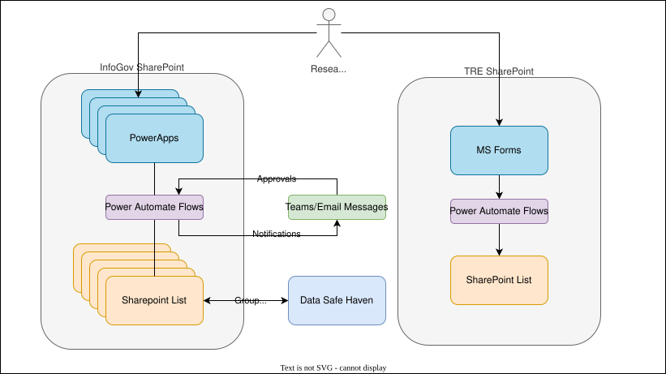
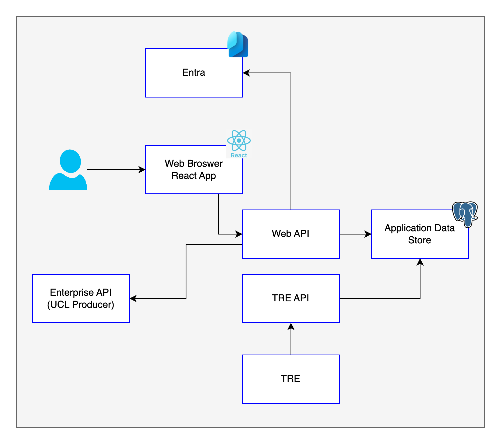
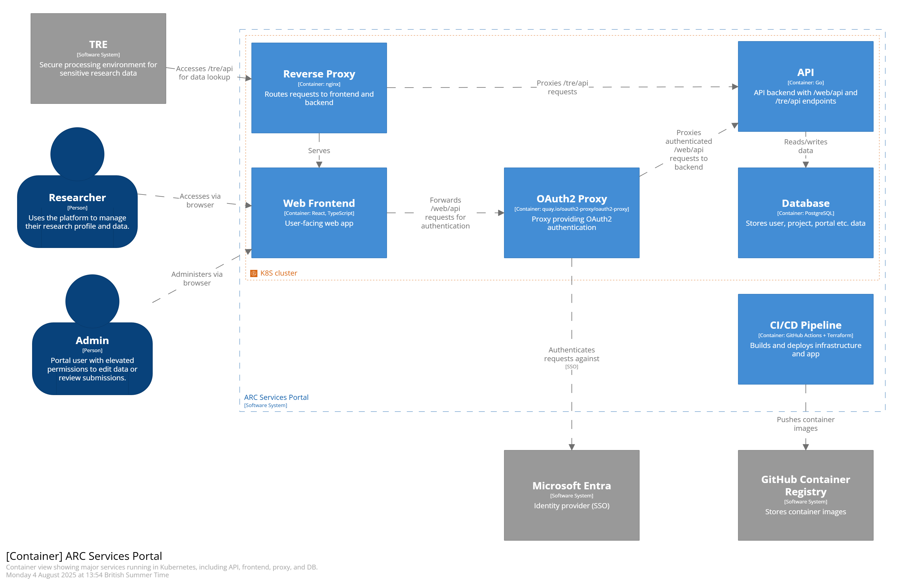
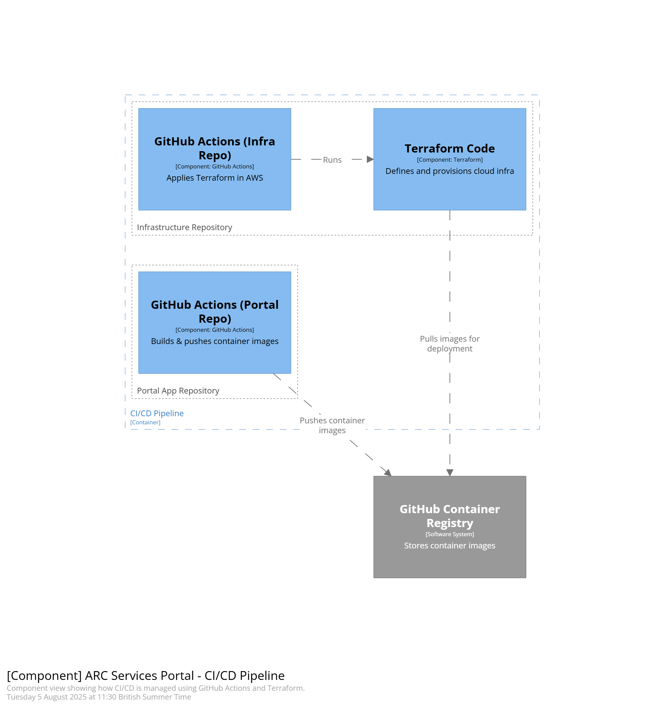
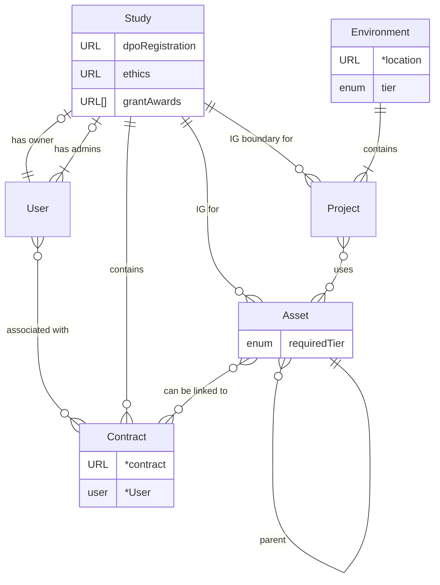

# ARC Services Portal HLD

## Introduction

The ARC services portal will support users creating and managing resources on ARC services such as TRE projects, RDSS shares, HPC access and Condenser projects. The initial use case laid out below is in support of the ARC TRE, Data Safe Haven and associated IG processes.

## The IG/TRE use case

In order to run the [Research Data ISMS](https://isms.arc.ucl.ac.uk/), ARC needs to ensure processes such as study creation and user onboarding are managed and collect quality data.

The replacement portal will manage [key ISMS processes](https://github.com/UCL-ARC/research-data-isms/tree/main/docs/Controlled_Processes). This portal will use the pathfinder project for ARC's metadata store based on
[this design](https://github.com/UCL-ARC/metadata-store/blob/main/doc/specification.md).
Some processes such as incident and service request will be managed through "MyServices" (Xurrent) as per the pattern detailed [here in option 2](https://github.com/UCL-ARC/ARC-Strategy-and-Design/blob/main/Docs/Service_Design/ARC_Experience_and_Service_Platforms.md).

## As-is IG Portal(s)

Current portal is hosted in SharePoint, the data related to cases and (AKA studies and projects) researchers etc. in several SharePoint lists. Users logon to the sharepoint portal with their UCL username and password and are able to see and update their existing studies, make requests for new studies and complete other compliance processes such as user onboarding and registering data assets.

### Example forms and project list

[Register new case/study](https://liveuclac.sharepoint.com/sites/ISD.IGAdvisoryService/Lists/Start%20a%20service%20request/NewForm.aspx)

[View my projects](https://liveuclac.sharepoint.com/sites/ISD.IGAdvisoryService/Lists/Cases/Portal.aspx)

## To-be Portal

The portal is comprised of a NextJS frontend that uses a web api to interact with a backend database. Further APIs for supported platforms (initially the ARC TRE) connect the to the data to provide or configure access to resources. The app will access UCL enterprise systems using one of the [UCL producer patterns](https://liveuclac.sharepoint.com/sites/it-architecture/SitePages/integration-patterns.aspx).

### Logical View

## Physical View

### Overview

The portal is deployed as a set of Kubernetes resources onto the ARC TRE's production/staging Amazon EKS clusters. A reverse proxy receives all incoming HTTPS requests, serving the web frontend at `/`, routing `/web/api` requests via an authentication proxy. TRE API requests are east-west to `/tre/api`.

As a target architecture, the diagram below shows how in the future, in addition to existing UCL TREs, other UCL systems and services will be able to access data in the portal database via api.

> [!NOTE]
> The `/tre/api` endpoint is not exposed externally because the portal and the ARC TRE run within the same Kubernetes cluster, allowing internal (east-west) access.

| Component            | Resource Type                 |
| -------------------- | ----------------------------- |
| Web Frontend         | Deployment using custom image |
| API                  | Deployment using custom image |
| Reverse Proxy        | Third party Helm Chart        |
| Authentication Proxy | Third party Helm Chart        |
| Postgres Database    | Third party Helm Chart        |

### Deployment Worflow

The diagram below shows the workflow that deploys the portal into the AWS VPC it currently resides in. The two sets of GitHub actions that run to deploy the app are grouped into the "Portal App Respository" and the "Infrastructure Respository". At present, the Portal App Repository is this GitHub repo. The Infrastructure Repository is the UCL ARC TRE's monorepo, a private repo which belongs to the [ucl-arc-tre GitHub organisation](https://github.com/ucl-arc-tre).

## Design Principles

Design will adhere to the [digital foundation principles](https://liveuclac.sharepoint.com/sites/it-architecture/SitePages/digital-foundation-principles.aspx).

Plus:

| Principle                           | Description                                                                                                                                                                                                                                                                                                                                    | Implementation                                                                                                                                   | Testing |
| ----------------------------------- | ---------------------------------------------------------------------------------------------------------------------------------------------------------------------------------------------------------------------------------------------------------------------------------------------------------------------------------------------- | ------------------------------------------------------------------------------------------------------------------------------------------------ | ------- |
| Reusable                            | The portal and underlying data structure will support a wide variety of use cases within ARC, initially focused on ARC services requiring similar functionality (EG. User onboarding)                                                                                                                                                          | Initially built around the TRE use case with input from the Research Computing and Research Data team to ensure designs support other use cases. | TBC     |
| Open Source                         | As much of the development should be made open source as possible with an output of the build being a design and code base.                                                                                                                                                                                                                    | TBC                                                                                                                                              | TBC     |
| Master state data in the right pace | The state data of services and resources will remain mastered within platforms. This will include access control to resources and configuration of infrastructure. These state data will be read from the platforms (Such as TRE, RDP and Condenser) and processes managed within the portal may trigger changes in state within the platform. | TBC                                                                                                                                              | TBC     |
| Retention of Quality Data           | Where processes within the portal make changes to metadata or resources adequate quality data will be captured and retained in line with the requirements of any downstream system.                                                                                                                                                            | TBC                                                                                                                                              | TBC     |

## Non-functional Requirements

### Data Classification

The portal and underlying data will be limited to storing confidential and public data.

### Availability

TBC

### Integrity

See above principle on quality data.

## Definition of the MVP

## Conceptual data model

This model represents an overview of the current understanding of the target main entities referenced in the project stories, with minimal detail. It improves in some respects from the model in the [as-is Portal](#as-is-portals).

Notes on syntax:

- [Crow's foot notation](https://en.wikipedia.org/wiki/Entity%E2%80%93relationship_model#Crow's_foot_notation)
- Some attributes use URLs to refer to entities in other systems. The local entity may express some inherited data about the referenced entity which is useful for local business rules, e.g. whether a Contract allows external users.

### Study

A **Study** is an abstract Information Governance boundary which is interpreted according to context. It may closely correspond to a real-world research study, a whole lab, or a research project or programme.

### Asset

An **Asset** belongs strictly to one **Study**. If the Study transfers an Asset to another Study, a new Asset is created. This should reference the original Asset through the `parent` relationship, so that provenance can be established. This relationship can carry additional information such as what derivation was used, e.g. anonymisation. An Asset can also belong to a Project within the same Study. If an Asset exists within a Project, it exists within that Project's Study.

### Contract

A **Contract** is a document that outlines the relationship a[n external] user has to the Study. This can be linked to an Asset.

### Project

The **Project** entity type is expected to be subtyped for specific Environments, including with User roles. E.g.

- The ARC TRE Project subtype specifies desktop users, ingressers, etc.
- The DSH Project subtype is called a "Share"
- The Condenser Project subject is called a "Tenancy"

See also [Metadata Store conceptual model](https://github.com/UCL-ARC/metadata-store/blob/main/doc/specification.md#7-entity-relationship-er-logical-models)

## Roles & permissions

The portal superimposes additional roles to the roles defined in the [Research Data ISMS](https://isms.arc.ucl.ac.uk/rism02-roles_and_responsibilities/). The following roles may be assigned to qualifying authenticated users of the portal.

**How it works**
- People get roles, roles carry permissions
- Backend enforces (default deny). Frontend shows/hides pages to match (to avoid showing users things they aren't allowed to use)
- Roles stack, there is no inheritance
- Creating studies/projects needs **Approved Staff Researcher**. An Ops/IG role alone doesn't grant it, staff can create/edit their own studies and projects if they are Approved Staff Researcher.

**User roles**
- **Base**
  - Who gets it: everyone in the UCL Entra tenant (incl. invited externals)
  - Can: view their own profile, training, agreements, notifications
  - Can't: search, create, edit or review studies or projects
- **Staff**
  - Who gets it: confirmed staff (not external users or students)
  - Can: no access alone comes from this, but it unlocks Approved Staff Researcher
- **Approved Researcher**
  - Who gets it: when you have signed the agreement & have valid training
  - Can: view studies, projects, assets, contracts you're part of, can be added as a member of a TRE project
  - Can't: search all studies/projects or create or review them
- **Approved Staff Researcher**
  - Who gets it: staff who have become Approved Researchers
  - Can: create studies and TRE projects (under an approved study they own), edit and submit their own for review, and look up users
  - Can't: search all studies/projects or review/approve
- **Information Asset Owner**
  - Who gets it: when you've signed the Study agreement for a study you own
  - Can: invite users (incl. external collaborators), manage your own studies (people, assets, contracts)
  - Can't: search all studies/projects, review/approve
- **Information Asset Administrator**
  - Who gets it: when you're added to a study as an Admin by its owner
  - Can: manage that study

**Per-study / per-project**
- **Study owner & study admins**: full control of that study and its projects
- **Project owner**: full control of that project

**Staff roles** (set in system config)
- **IG Ops**
  - Who gets it: ARC Info Gov Advisory Team member
  - Can: view all users, studies, projects (TRE + DSH). Manage training records & invites, study admin tasks (incl. review/approve studies), and the metrics page
  - Can't: review/approve projects or review/approve a study they own or administer
- **IG Admin**
  - Who gets it: senior ARC Info Gov Advisory Team member
  - Can: IG Ops & edit any study
  - Can't: as IG Ops
- **TRE Ops**
  - Who gets it: UCL TRE service member
  - Can: view all users, studies, projects. Approve TRE projects (not their own), issue/revoke access keys the TRE uses to connect to the Portal
  - Can't: review/approve studies or edit studies/projects they don't own
- **DSH Ops**
  - Who gets it: UCL DSH service member
  - Can: view all users, studies, DSH projects, issue/revoke access keys the DSH uses to connect to the Portal
  - Can't: review/approve studies or create, edit or review DSH projects (view only, updates only via API)
- **Administrator**
  - Who gets it: ARC Services Portal Admin
  - Can: everything, incl. creating studies/projects
  - Can't: review/approve studies through the UI (backend allows it, but no frontend action exists yet)

## Audit logging

*Sources: portal/internal/service/audit, portal/internal/types (audit record definition)*

**Logged actions**
- Study: created, review status changed (+ reviewer feedback), signed off
- Study admins: assigned, removed
- Study owner change: requested, approved
- Project: created, approved, members' roles set, deleted
- Project access review signed off
- User training record updated

**Each entry records**
- Who (user, linked to username)
- Change type: create / update / delete
- What: item type (study / project / training record), ID, name if available
- Short description, e.g. titles, usernames, new status
- When (timestamp)
- "Uploaded" yes/no flag

**Mechanics**
- Written to Portal database in the same operation as the change
- Errors if the record can't be saved

**Not logged here**
- Logins/logouts
- Viewing data
- Refused access attempts
- Role changes

## Database backups

*Source: TREu/deploy/modules/system/portal (postgres.tf)*

**Setup**
- PostgreSQL run by CloudNativePG
- 3 synced copies for availability

**Frequency**
- Full backup daily, 04:51
- Continuous change-log archiving, so point-in-time restore is possible

**Storage**
- AWS S3 bucket, same region as the Portal, "postgres" folder
- Access via dedicated cloud role or backup-only access keys
- DB network locked down: outbound only to backup storage + essential internal services, inbound only from the Portal app
- Encrypted 

**Retention**
- 

**Restore**
- Manual, done by an engineer
- Switch config to "recovery" mode → redeploy → new DB built from S3 backups
- Restores to latest state, or a chosen point in time
- Restored DB must back up to a different folder so the source backups aren't overwritten

## Application, database and integration design

The portal and database will use the Experience Layers [here](https://github.com/UCL-ARC/ARC-Strategy-and-Design/blob/main/Docs/Service_Design/ARC_Experience_and_Service_Platforms.md#4-experience-layers).

The portal will align to [this design](https://github.com/UCL-ARC/ARC-Strategy-and-Design/blob/main/Docs/Service_Design/ARC_Experience_and_Service_Platforms.md#62-option-2---portal-only-workflows-recommended-option) option to support researchers acknowledging that service request will still be submitted and managed in MyServices.

The overall design will be based on [The UCL Experience Framework](https://liveuclac.sharepoint.com/sites/it-architecture/SitePages/EF-architecture-patterns.aspx) (Pattern 4).
