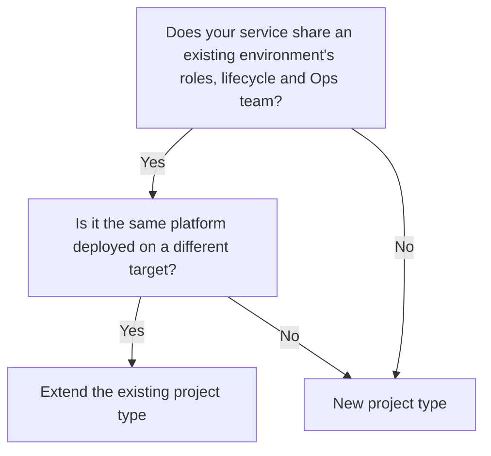
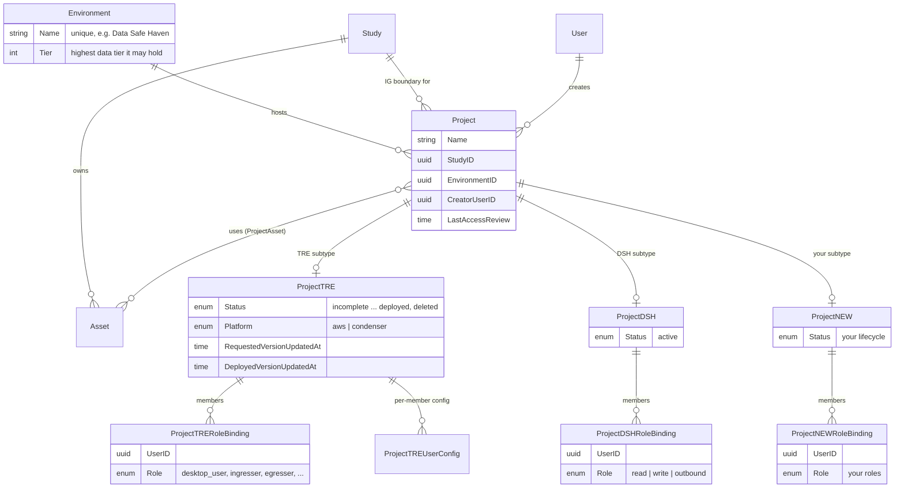

# Onboarding a Service to the ARC Services Portal

This guide is for owners of ARC and UCL services who want their service to use the ARC Services Portal ("the Portal") to manage research projects, users and information governance (IG).

- **Part 1** is for everyone. It explains what the Portal does, what your service gets from it, the main decision you need to make and how onboarding works.
- **Part 2** is for the engineers who build the integration. It covers the data model, the APIs and the work each team does.

See also the [High-Level Design](./High-Level_Design.md) and the C4 model in [c4/workspace.dsl](./c4/workspace.dsl).

---

## Part 1: Overview

### What the Portal is

The Portal is where researchers and IG staff manage the governance around research data at UCL. It replaces the SharePoint-based IG and TRE portals. It runs the controlled processes of the [Research Data ISMS](https://isms.arc.ucl.ac.uk/), such as study registration, user onboarding, training records and agreements.

Platforms such as the ARC Trusted Research Environment (TRE) and the Data Safe Haven (DSH) connect to the Portal. They use it to find out who may access which project and to keep the Portal up to date with what is deployed.

<!-- TODO: export view C1-Portal-Context from ./c4/workspace.dsl -->

### Key concepts

| Concept                 | What it means                                                                                                                                                                    |
| ----------------------- | -------------------------------------------------------------------------------------------------------------------------------------------------------------------------------- |
| **Study**               | An IG boundary. It may be a research study, a lab or a programme. It has an owner, admins, assets and contracts, and IG staff approve it.                                        |
| **Asset**               | A data asset that belongs to one study, with a data classification tier.                                                                                                         |
| **Contract**            | An agreement such as a data sharing agreement, linked to a study and optionally to assets.                                                                                       |
| **Environment**         | A platform where project work happens, for example "ARC Trusted Research Environment" or "Data Safe Haven". Each environment has a **tier**: the most sensitive data it may hold. |
| **Project**             | A piece of work in one environment under one study. For example, a TRE project or a DSH share.                                                                                   |
| **Project type**        | The environment-specific details of a project: its members' roles, its lifecycle statuses and its configuration.                                                                 |
| **Approved Researcher** | A user who has signed the required agreement and has valid training. Only Approved Researchers can be project members.                                                           |

A **project always sits under an approved study**. This is how the Portal ties work on your platform back to an IG boundary.

### What your service gets

- **Governed membership.** You know which users are Approved Researchers and when their training expires, so your platform can refuse access to anyone who doesn't qualify.
- **IG linkage.** Every project is tied to an approved study with a case reference, an owner and admins.
- **Self-service requests and approval** (if you choose the pull pattern below). Researchers request projects in the Portal, and your Ops staff approve them there.
- **An audit trail.** Project creation, approval, membership changes and deletion are recorded with who made the change and when.
- **An Ops role for your team.** Your staff can view your projects and issue the API tokens your platform uses.

### The main decision: a new project type, or an extension of an existing one?

Every service that joins the Portal does so in one of two ways.

**1. A new project type.** Your service becomes a new **Environment** with its own project type, member roles, statuses, API and Ops role. The **ARC TRE** (TRE projects) and the **Data Safe Haven** (DSH shares) were onboarded this way.

**2. An extension of an existing project type.** Your service is another deployment target of an environment that already exists. It reuses that environment's project type, roles, approval flow and API, and adds only what is different, usually a new option on the existing project type. **Condenser** was onboarded this way: it is another platform that ARC TRE projects can be deployed to, chosen by the `platform` field on a TRE project, and its components are essentially the same as the ARC TRE's.

Use these questions to decide:

| Question                                                                                     | If yes, it points to |
| -------------------------------------------------------------------------------------------- | -------------------- |
| Does your service have its own environment tier or ISMS environment scope?                   | New project type     |
| Do project members need roles that the existing environment doesn't have?                     | New project type     |
| Does a project go through a different lifecycle or approval process?                         | New project type     |
| Is a different operations team responsible for approving and supporting projects?            | New project type     |
| Is your service the same platform deployed somewhere else, with different technology underneath? | Extend existing      |
| Would the existing environment's Ops team approve and support your projects?                 | Extend existing      |
| Do researchers think of it as "a TRE project, but on X"?                                     | Extend existing      |

If you're not sure, say so in your onboarding issue and the Portal team will help you decide.

> [!IMPORTANT]
> Extending an existing project type changes something another service depends on. The owner of that environment, such as the ARC TRE team for TRE projects, has to agree to the change.

### How your platform talks to the Portal

There are two integration patterns. Both are in use and both are equally valid. Pick the one that matches where your projects are created.

|                                | **Pull** (used by the ARC TRE)                                                                     | **Push** (used by the Data Safe Haven)                                                                              |
| ------------------------------ | -------------------------------------------------------------------------------------------------- | ------------------------------------------------------------------------------------------------------------------- |
| Where projects are requested   | In the Portal, by researchers                                                                      | In your platform, through your existing process                                                                     |
| Who approves projects          | Your Ops staff, in the Portal                                                                      | Your platform's existing process                                                                                    |
| What your platform does        | Regularly fetches the projects it should have, deploys or changes them, and reports their status back | Fetches approved studies and researchers to check requests locally, then sends its current project membership to the Portal |
| Who edits projects in the Portal UI | Researchers and Ops staff                                                                   | Nobody: projects are view-only in the Portal UI and updated only through the API                                    |
| Suits                          | New services, or services that want self-service requests                                          | Established services with their own provisioning workflow                                                          |

In both patterns, the state of the platform is mastered in the platform: the Portal holds what was requested and approved, and what the platform reports. See the "Master state data in the right place" principle in the [HLD](./High-Level_Design.md#design-principles).

### Before you start

You need all of the following before your service can go live. You can start the technical conversation in parallel.

- [ ] **Environment tier assessed.** Your service has an environment tier under the [data classification and environment tiering policy (RISM06)](https://isms.arc.ucl.ac.uk/rism06-data_classification_and_environment_tiering_policy/#4-environment-tiers-and-data-classification). This sets the most sensitive data your projects can hold.
- [ ] **In ISMS scope, with IG sign-off.** Your service is within the scope of the Research Data ISMS, or the ARC IG Advisory team has agreed to the onboarding.
- [ ] **Named Ops role holders.** You have named the staff who will hold your service's Ops role. They approve projects (pull pattern), view your projects and issue and revoke your platform's API tokens.
- [ ] **Data protection review.** You have a data protection impact assessment, or a data flow review, covering the personal data the Portal will share with your service: usernames, names, emails, approved researcher status and training dates.

> [!NOTE]
> The Portal stores only confidential and public data. It holds metadata about projects, studies and people, never research data. Your integration must not send research data to the Portal.

### The onboarding process

1. **Open an issue.** Open a [new issue](https://github.com/ucl-arc-tre/portal/issues/new) on this repository titled `Service onboarding: <service name>` and include the information listed [below](#what-to-put-in-your-onboarding-issue).
2. **Governance.** Work through the [prerequisites](#before-you-start) with the ARC IG Advisory team and your data protection contacts.
3. **Design session.** You and the Portal team decide between a new project type and an extension, choose the integration pattern, and agree the roles, statuses and fields your projects need.
4. **API contract.** The Portal team drafts the OpenAPI specification for your API, or the change to an existing one, as a pull request. Both teams review it before any code is written.
5. **Portal build.** The Portal team builds the Portal side: data model, API, roles, UI and tests. It is released to staging.
6. **Platform build.** Your team builds the client in your platform against staging. Your Ops staff issue a staging API token in the Portal.
7. **Go-live.** The Portal team releases to production and configures your Ops role holders, and your Ops staff issue a production token. The Portal team updates the [HLD](./High-Level_Design.md) roles section and the [C4 model](./c4/workspace.dsl).
8. **Ongoing.** Your Ops staff rotate tokens before they expire (at most every 365 days). Request changes to your integration with a new issue.

### What to put in your onboarding issue

- Service name, owner and the team that will support it
- A short description of the service and who uses it
- Your environment tier, or where the assessment has got to
- Whether you think it's a **new project type** or an **extension**, and why
- Your preferred **integration pattern** (pull or push), and how projects are created today
- The **roles** project members need (for example read, write, outbound) and what each one allows
- The **lifecycle** of a project on your platform (for example requested, approved, deployed, deleted)
- Any **per-project or per-member configuration** your platform needs from the Portal
- The data your platform needs from the Portal, and the data it can send back
- Named Ops role holders
- Target dates and any dependencies

---

## Part 2: Technical detail

### Architecture

The Portal is a Go API with a Next.js frontend, backed by PostgreSQL and deployed on the ARC TRE's Amazon EKS clusters. Each platform has its own API on its own path, described by its own OpenAPI specification:

| API                 | Path            | Specification                           | Authentication                                        |
| ------------------- | --------------- | --------------------------------------- | ----------------------------------------------------- |
| Web (frontend only) | `/web/api/v0`   | [api/web.yaml](../api/web.yaml)         | Entra ID through OAuth2 Proxy                         |
| ARC TRE             | `/tre/api/v0`   | [api/tre.yaml](../api/tre.yaml)         | JWT bearer token (`tre:r`, `tre:w`) or HTTP Basic      |
| Data Safe Haven     | `/dsh/api/v0`   | [api/dsh.yaml](../api/dsh.yaml)         | JWT bearer token (`dsh:r`, `dsh:w`)                   |
| Your service        | `/<svc>/api/v0` | `api/<svc>.yaml`                        | JWT bearer token (`<svc>:r`, `<svc>:w`)               |

<!-- TODO: export view C2-Portal-Platform-Integrations from ./c4/workspace.dsl -->

Inside the API, each request passes through middleware that checks the JWT signature, expiry and required scopes, and applies rate and body-size limits. The request then reaches your service's handlers, which call the shared backend services.

<!-- TODO: export view C3-API-Platform-Integration from ./c4/workspace.dsl -->

### Data model

Projects use a **generic table plus subtype** pattern. Every project has one generic `Project` row that links it to a study and an environment. Each environment adds its own subtype table holding everything specific to it. The core types are in [internal/types/projects.go](../internal/types/projects.go), [studies.go](../internal/types/studies.go) and [environments.go](../internal/types/environments.go).

Points to note:

- **Users** are identified by `Username`: an email-style identifier: the UPN for UCL users (e.g. `ccxyz@ucl.ac.uk`), and a username outside the UCL domain for invited external users. Your platform needs a way to map these to its own accounts.
- **Role bindings** are one row per user per role. A user can hold several roles on the same project.
- **Statuses** are your project lifecycle. The ARC TRE's status set (`incomplete` → `pending-approval` → `pending-creation` → `deployed` → `pending-deletion` → `deleted`) is a good model for the pull pattern.
- **Requested and deployed versions.** `ProjectTRE` uses `RequestedVersionUpdatedAt` and `DeployedVersionUpdatedAt` so the platform can tell when a project has changed since it last deployed it. Consider the same approach if you use the pull pattern.
- **Every table is auditable.** Rows carry created, updated and soft-deleted timestamps.

#### New project type: what changes

- A new `Environment` row (name and tier) in [internal/service/environments/init.go](../internal/service/environments/init.go)
- New `Project<Svc>` and `Project<Svc>RoleBinding` tables, plus any per-member config table you need
- New status and role enumerations

#### Extending an existing project type: what changes

- A new value on an existing enumeration (as `condenser` was added to `ProjectTREPlatform`), or new optional fields on the existing subtype
- Any platform-specific reference data, such as `ProjectTREVMImage`, which is keyed by platform
- Changes to the existing API specification. These must stay backwards compatible for the existing platform's clients.

### Authentication and tokens

- Platforms authenticate with **JWT bearer tokens signed by the Portal** (Ed25519). Each token is bound to one environment and carries that environment's scopes: `<svc>:r` for reads and `<svc>:w` for writes. The OpenAPI specification declares which scope each endpoint needs.
- Your **Ops staff issue and revoke tokens** in the Portal UI. A token is valid for at most **365 days**, so plan for rotation.
- Store tokens in your platform's secret store and never commit them to source control.
- HTTP Basic authentication exists only for the ARC TRE. New services won't be offered it.

### Roles and permissions

A new project type adds a `<Service> Ops` staff role, set in system config and enforced with [Casbin](https://casbin.org/) in [internal/rbac](../internal/rbac/). Following the TRE Ops and DSH Ops roles, it usually allows Ops staff to:

- view all users and studies
- view all of your service's projects
- approve your projects (pull pattern only, and never a project they own)
- issue and revoke your service's API tokens

Project creation follows the general rules in the [HLD](./High-Level_Design.md#roles--permissions). Only an **Approved Staff Researcher** can create a project, and only under an approved study they own or administer. Only **Approved Researchers** can be project members.

### The two patterns in the API

**Pull (ARC TRE example, [api/tre.yaml](../api/tre.yaml)):**

| Endpoint                           | Purpose                                                           |
| ---------------------------------- | ----------------------------------------------------------------- |
| `GET /projects`                    | List the projects the platform should have, with members and config |
| `POST /projects/{projectName}`     | Report a project's status (e.g. `deployed`, `deleted`)            |
| `GET /user-status?username=…`      | Check if a user is an Approved Researcher and when their training expires |

**Push (DSH example, [api/dsh.yaml](../api/dsh.yaml)):**

| Endpoint                     | Purpose                                                               |
| ---------------------------- | --------------------------------------------------------------------- |
| `GET /approved-studies`      | List approved studies (case reference, owner, admins)                 |
| `GET /approved-researchers`  | List Approved Researchers                                             |
| `POST /import/share-members` | Replace the platform's project membership in the Portal with the uploaded data |

Every API also has `GET /ping` so you can check connectivity and authentication. Your API will be designed for your service, but expect it to look like one of these two.

### Who builds what

| The Portal team builds                                                                                         | Your team builds                                                                                         |
| -------------------------------------------------------------------------------------------------------------- | -------------------------------------------------------------------------------------------------------- |
| The OpenAPI specification (`api/<svc>.yaml`), agreed with you                                                  | A client for the Portal API in your platform (you can generate it from the OpenAPI specification)       |
| Data model changes and migrations                                                                              | Mapping Portal usernames to your platform's accounts                                                     |
| API handlers, mounting at `/<svc>/api/v0`, JWT scopes                                                          | Polling and reconciliation (pull) or scheduled export (push)                                             |
| The `<Service> Ops` role and its policies, and token issuance for your environment                             | Enforcing Approved Researcher status and roles on your platform                                          |
| UI pages to create, review and view your projects                                                              | Reporting status or membership back to the Portal                                                        |
| Audit events and notifications                                                                                 | Secure token storage and rotation                                                                        |
| Unit and end-to-end tests, staging and production releases                                                     | Testing against Portal staging                                                                           |
| Updates to the HLD and the C4 model                                                                            | Runbooks for your Ops staff                                                                              |

### Things to bear in mind

- **The API is versioned (`v0`).** Breaking changes to an API that a platform already uses need agreement from that platform's owner, and a new version if necessary.
- **Rate limits apply** to every platform API. Poll on a schedule at a sensible interval, not once per user action.
- **Deletions are soft.** Rows are marked deleted rather than removed, so they stay available for audit.
- **The Portal is not your source of truth for deployed state.** Your platform is, and the Portal reflects what you report.

### Questions

Ask on your onboarding issue, or open a [new issue](https://github.com/ucl-arc-tre/portal/issues/new).
