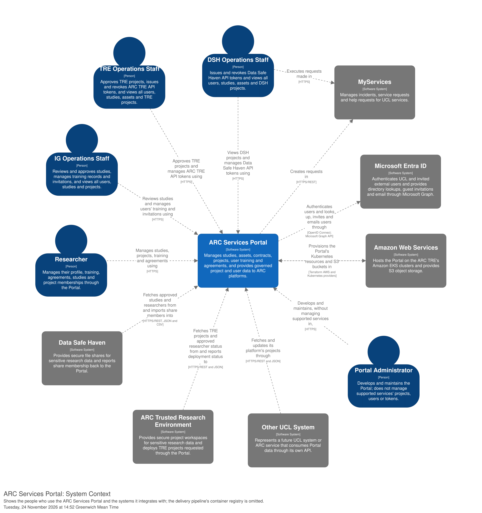
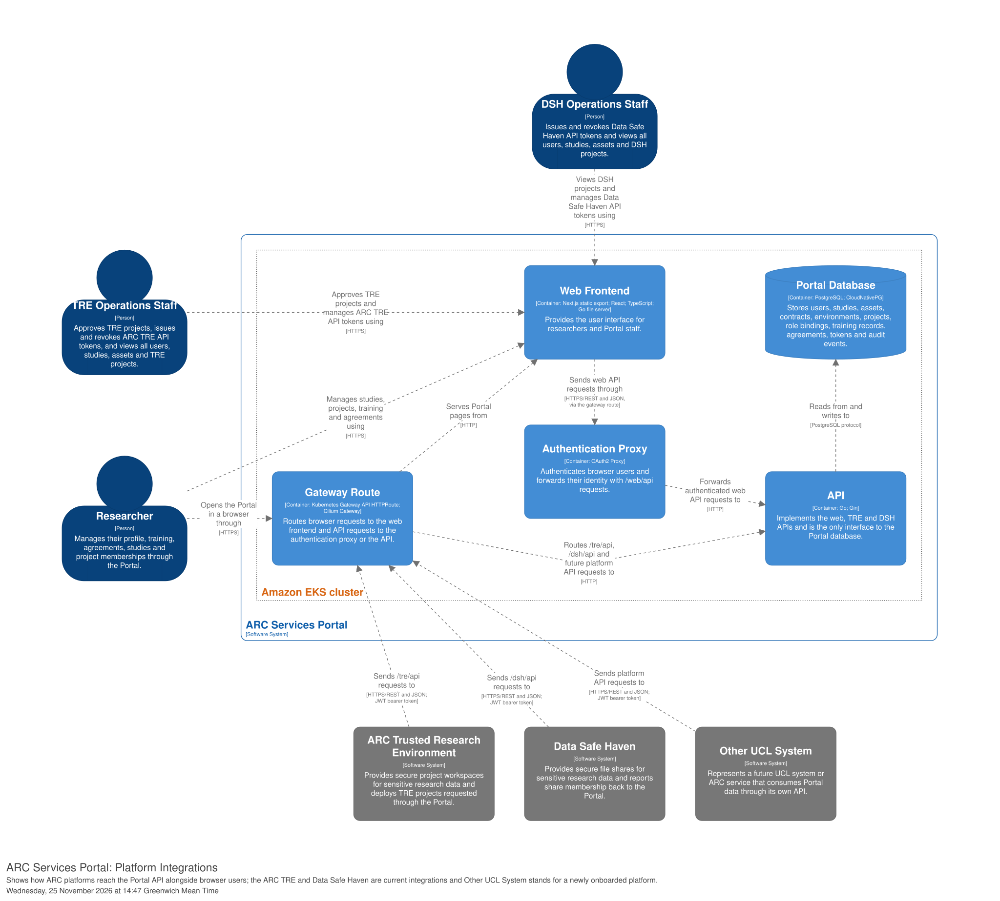
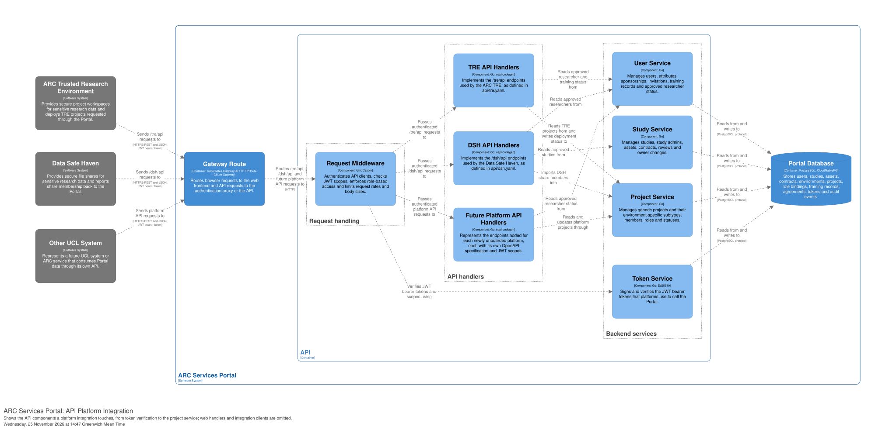
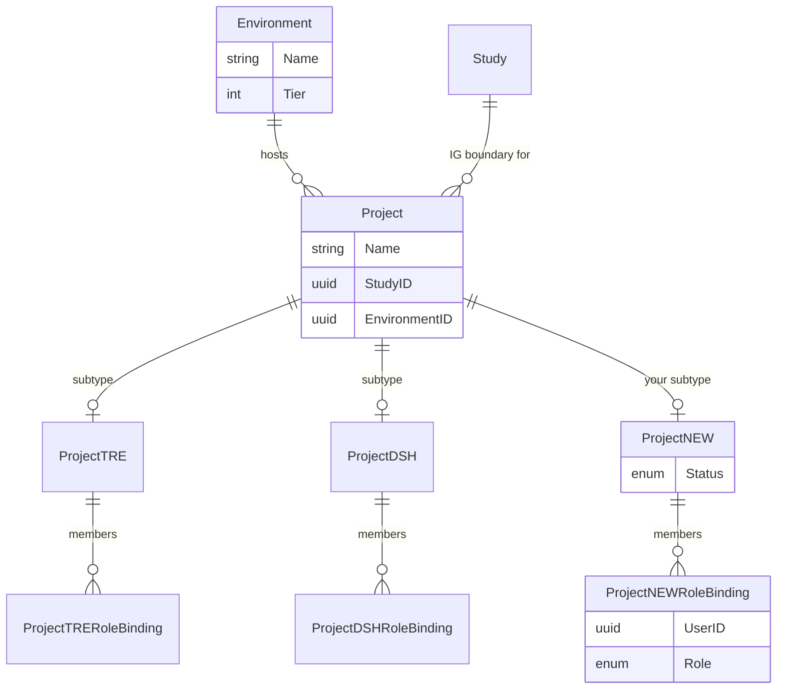

# Onboarding a Service to the ARC Services Portal

This guide is for owners of ARC and UCL services that want to use the ARC Services Portal to govern their projects and users. Part 1 covers what onboarding involves. Part 2 is for the engineers building the integration.

See also the [High-Level Design](./High-Level_Design.md).

## Part 1: Overview

### What the Portal does

The Portal runs the controlled processes of the [Research Data ISMS](https://isms.arc.ucl.ac.uk/): study registration and approval, user onboarding, training records and agreements. Platforms connect to it to find out which approved researchers may access which projects, and to report back what they have deployed.

The ARC Trusted Research Environment (TRE) and the Data Safe Haven (DSH) are connected today.

### Key concepts

| Concept             | Meaning                                                                                                   |
| ------------------- | --------------------------------------------------------------------------------------------------------- |
| Study               | An IG boundary with an owner, admins, assets and contracts. Approved by the IG Advisory team.             |
| Environment         | A platform where project work happens, with a tier setting the most sensitive data it may hold.           |
| Project             | Work in one environment under one approved study, e.g. a TRE project or a DSH share.                      |
| Project type        | The environment-specific part of a project: member roles, lifecycle statuses and configuration.           |
| Approved Researcher | A user who has signed the researcher agreement and has valid training. Only they can be project members.  |

### What your service gets

- A reliable answer to "is this user an Approved Researcher, and is their training valid?"
- Every project tied to an approved study, with a case reference, owner and admins
- An audit trail of project creation, approval, membership changes and deletion
- An Ops role for your team to view your projects and issue API tokens
- Optionally, self-service project requests that your Ops team approves in the Portal

### Decide: new project type or extension

**New project type.** Your service becomes a new environment with its own project type, roles, statuses, API and Ops role. The TRE and DSH were onboarded this way. This is the usual route.

**Extension of an existing project type.** Your service adds an option or fields to a project type that already exists, and reuses its roles, approval flow, API and Ops team. This only fits when your service is a variant of an existing environment rather than a separate one. The owner of that environment must agree to the change.

### Decide: pull or push

Both patterns are in use. Pick the one that matches where projects are created.

|                         | Pull (TRE)                                                      | Push (DSH)                                                            |
| ----------------------- | --------------------------------------------------------------- | --------------------------------------------------------------------- |
| Projects are requested  | in the Portal by researchers                                    | through your existing process                                          |
| Projects are approved   | in the Portal by your Ops staff                                 | through your existing process                                          |
| Your platform           | fetches the projects it should have and reports their status    | fetches approved studies and researchers, and sends its membership back |
| Projects in the Portal UI | editable by researchers and Ops staff                         | read-only                                                              |

Either way, your platform remains the source of truth for what is deployed. The Portal holds what was requested and approved, and what your platform reports.

### Prerequisites

Before go-live you need:

- an environment tier under [RISM06](https://isms.arc.ucl.ac.uk/rism06-data_classification_and_environment_tiering_policy/#4-environment-tiers-and-data-classification)
- your service in the Research Data ISMS scope, or sign-off from the ARC IG Advisory team
- named staff to hold your service's Ops role
- a data protection review (DPIA or data flow review) covering the personal data the Portal shares with you: usernames, names, emails, Approved Researcher status and training dates

The Portal holds metadata about studies, projects and people. It never holds research data, and your integration must not send any.

### Process

1. Complete the prerequisites with the IG Advisory team and your data protection contacts.
2. Agree with the Portal team the project type, integration pattern, roles, statuses and fields.
3. The Portal team drafts the OpenAPI specification as a pull request, and both teams review it.
4. The Portal team builds the Portal side and releases it to staging.
5. Your team builds its client against staging, using a token issued by your Ops staff.
6. The Portal team releases to production and assigns your Ops role. Your Ops staff issue a production token.
7. Your Ops staff rotate tokens before they expire, at most every 365 days.

## Part 2: Technical detail

### APIs

The Portal is a Go API and a Next.js frontend backed by PostgreSQL, running on the ARC TRE's Amazon EKS clusters. Each platform has its own API path and OpenAPI specification.

| API             | Path            | Specification                   | Authentication                                    |
| --------------- | --------------- | ------------------------------- | ------------------------------------------------- |
| Web frontend    | `/web/api/v0`   | [api/web.yaml](../api/web.yaml) | Entra ID via OAuth2 Proxy                         |
| ARC TRE         | `/tre/api/v0`   | [api/tre.yaml](../api/tre.yaml) | JWT (`tre:r`, `tre:w`) or HTTP Basic              |
| Data Safe Haven | `/dsh/api/v0`   | [api/dsh.yaml](../api/dsh.yaml) | JWT (`dsh:r`, `dsh:w`)                            |
| Your service    | `/<svc>/api/v0` | `api/<svc>.yaml`                | JWT (`<svc>:r`, `<svc>:w`)                        |

Requests pass through middleware that verifies the JWT and its scopes and applies rate and body-size limits, then reach your service's handlers.

Existing endpoints show what the two patterns look like:

| Pattern | Endpoint                          | Purpose                                                         |
| ------- | --------------------------------- | --------------------------------------------------------------- |
| Pull    | `GET /projects`                   | Projects the TRE should have, with members and configuration    |
| Pull    | `POST /projects/{projectName}`    | Report a project's status                                       |
| Pull    | `GET /user-status`                | A user's Approved Researcher status and training expiry          |
| Push    | `GET /approved-studies`           | Approved studies with case reference, owner and admins           |
| Push    | `GET /approved-researchers`       | Approved Researchers                                             |
| Push    | `POST /import/share-members`      | Replace the DSH's project membership with the uploaded CSV       |

Every API has `GET /ping` for checking connectivity and authentication.

### Data model

Each project has a generic `Project` row linking it to a study and an environment, and a row in an environment-specific subtype table. See [internal/types](../internal/types/).

A new project type adds:

- an `Environment` row in [internal/service/environments/init.go](../internal/service/environments/init.go)
- `Project<Svc>` and `Project<Svc>RoleBinding` tables, with status and role enumerations
- any per-member configuration table you need

An extension adds fields or enumeration values to an existing subtype. Changes to that subtype's API must stay backwards compatible.

Users are identified by username: the UPN for UCL users (e.g. `ccxyz@ucl.ac.uk`) and a non-UCL username for invited external users. Your platform maps these to its own accounts. Role bindings are one row per user per role.

For the pull pattern, follow the TRE's approach: a status lifecycle (`incomplete`, `pending-approval`, `pending-creation`, `deployed`, `pending-deletion`, `deleted`) and requested/deployed timestamps so the platform can tell when a project has changed.

### Tokens and roles

Platforms authenticate with Ed25519-signed JWTs issued by the Portal. Each token is bound to one environment and carries its `<svc>:r` and `<svc>:w` scopes. Your Ops staff issue and revoke tokens in the Portal, and each token lasts at most 365 days. HTTP Basic is only supported for the TRE.

A new project type adds a `<Service> Ops` role in [internal/rbac](../internal/rbac/). Based on the TRE Ops and DSH Ops roles, it lets your staff view all users and studies, view your projects, issue your tokens and, for pull, approve projects they don't own.

Only Approved Staff Researchers can create projects, and only under approved studies they own. Only Approved Researchers can be members.

### Who builds what

| Portal team                                    | Your team                                              |
| ---------------------------------------------- | ------------------------------------------------------ |
| OpenAPI specification, agreed with you         | API client, generated from the specification           |
| Data model and migrations                      | Mapping Portal usernames to platform accounts          |
| API handlers and JWT scopes                    | Polling (pull) or scheduled export (push)              |
| Ops role, policies and token issuance          | Enforcing Approved Researcher status and roles          |
| UI pages for your projects                     | Reporting status or membership to the Portal           |
| Audit events and notifications                 | Token storage and rotation                             |
| Tests and releases                             | Testing against staging                                |
| HLD and C4 model updates                       | Runbooks for your Ops staff                            |

Breaking changes to a platform's API need that platform owner's agreement. Platform APIs are rate limited, so poll on a schedule rather than per user action.
